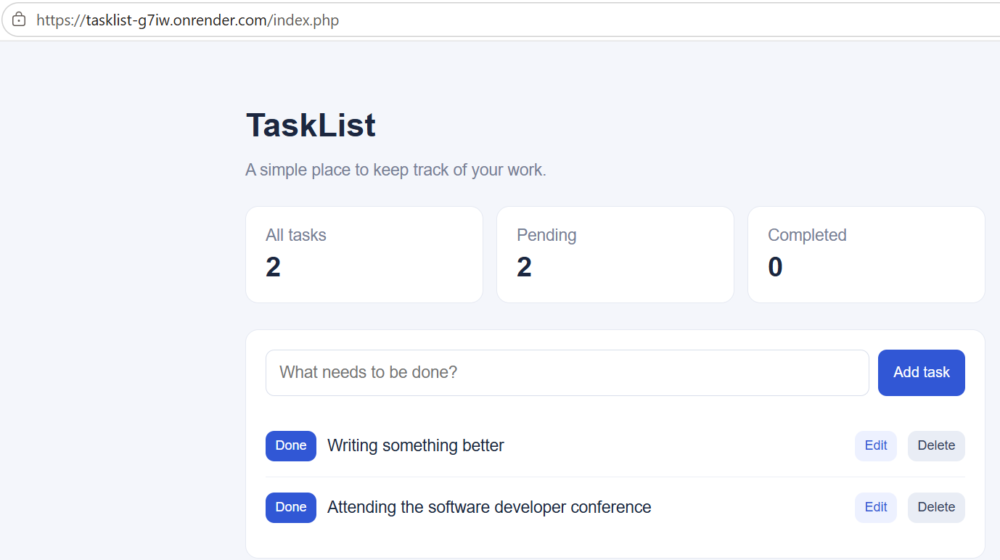

# TaskList

A tiny single-user task manager built with PHP, inspired by [TaskFlow](https://github.com/priandoyo/taskflow).

<p align="center">
  <a href="https://tasklist-g7iw.onrender.com/index.php">
    <strong>🚀 Live Demo: tasklist-g7iw.onrender.com</strong>
  </a>
</p>



## Features

- Add tasks
- Edit task titles
- Mark tasks as complete or pending
- Delete tasks
- View all, pending, and completed task counts

## Technology

- PHP 8.3
- Apache
- JSON file storage
- Docker
- Render

## Run locally

Make sure PHP is installed, then run this command from the project directory:

```bash
php -S localhost:8000
```

Open http://localhost:8000 in your browser.

## Deploy to Render

This repository includes a `Dockerfile`, so it can be deployed as a Docker Web Service:

1. Create a new **Web Service** in [Render](https://render.com/).
2. Connect this GitHub repository: `priandoyo/tasklist`.
3. Select the **Docker** runtime.
4. Keep the Dockerfile path as `./Dockerfile`.
5. Deploy the service.

Render builds the Docker image and runs the application using Apache.

**Live application:** [https://tasklist-g7iw.onrender.com/index.php](https://tasklist-g7iw.onrender.com/index.php)

## Data storage

Tasks are stored in `data.json`, created automatically when the application saves its first task.

The file is stored in the application directory by default. On hosting platforms with ephemeral filesystems, data may be lost when the service restarts or is redeployed. Use persistent storage or a database if you need durable data.

## Scope

TaskList is a small learning and demonstration project. It is designed as a simple single-user task manager and does not include authentication or multi-user access.
